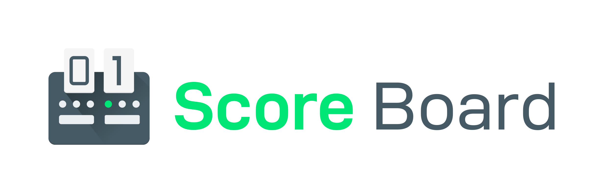
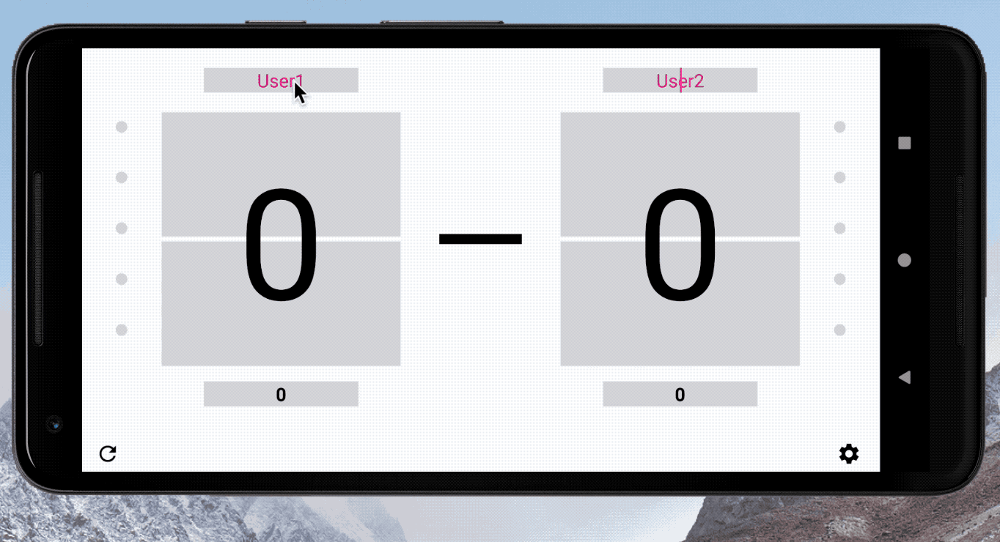

# Score Board

### Simple android app which can record table tennis score data

<h1 align=center>

</h1>

  

## Demo

  

## Download here 

## Unknown-ball support (fork)

When watching a match from the sideline you sometimes miss who won a ball. Press **没看清 ?** in the centre and the
ball is recorded as *unknown*: it counts as a ball played (so the serve order stays correct) but gives nobody a
point. Later open **记录** and tap the `?` ball to assign it; the score is recalculated.

- Upper half of each side: that player scores. Lower half of each side / **撤销**: undo the last ball.
- Rules: 11 points, win by 2, serve changes every 2 balls, every ball after 10:10.
- A game with unresolved `?` balls that could decide it is not closed automatically; resolve them first.
- Match logic lives in `match/` (`Game`, `Match`) and is unit-tested (`app/src/test/.../match`).
